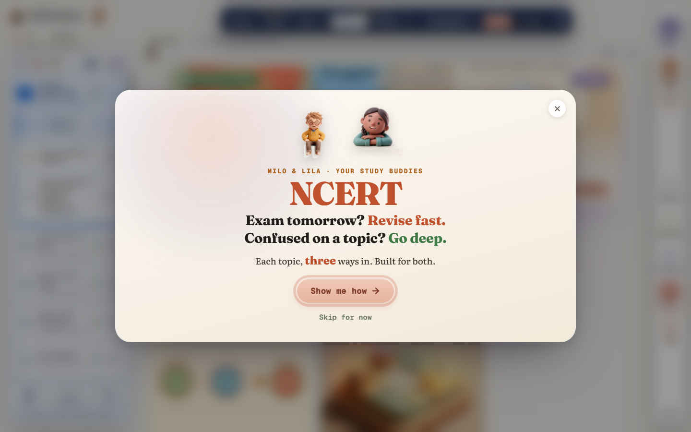

# NCERT Shorts

### Exam tomorrow? Revise fast. Confused on a topic? Go deep.

**[ncertshorts.com](https://ncertshorts.com)**

 

 

## What it is

A student the night before an exam and a student who is lost on a topic need different things from the same chapter.
NCERT Shorts gives every topic of Class X Science more than one way in, so each of them finds theirs.

All 13 chapters are covered, from Chemical Reactions and Equations to Our Environment.

## What you can do

| You have | Use | It gives you |
|---|---|---|
| Two minutes | **Recap** | The chapter in its shortest form |
| Seven minutes | **Vocab** | The words the chapter turns on |
| Fifteen minutes | **Quiz** | Questions that show what you missed |
| Half an hour | **Theory** | The full idea, as cards with pictures |
| A doubt | **Ask** | Milo and Lila, the study buddies, answer about the page you are on |
| A hard problem | **Practice**, **Simplify**, **Example**, **Trap** | Worked problems, a plainer telling, an example, and the mistake examiners wait for |

## About this repository

This is the public home of NCERT Shorts: what it is, what it looks like, and where to send feedback.

| | |
|---|---|
| **The product** | [ncertshorts.com](https://ncertshorts.com) |
| **Feedback and corrections** | Open an [issue](../../issues) |
| **The source code** | Not published. This repository holds no application code |

 

Built by Abbas Shaheer &nbsp;·&nbsp; © 2026, all rights reserved

