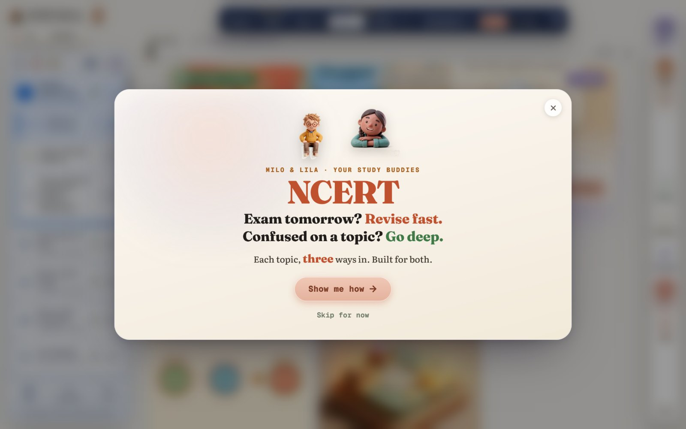
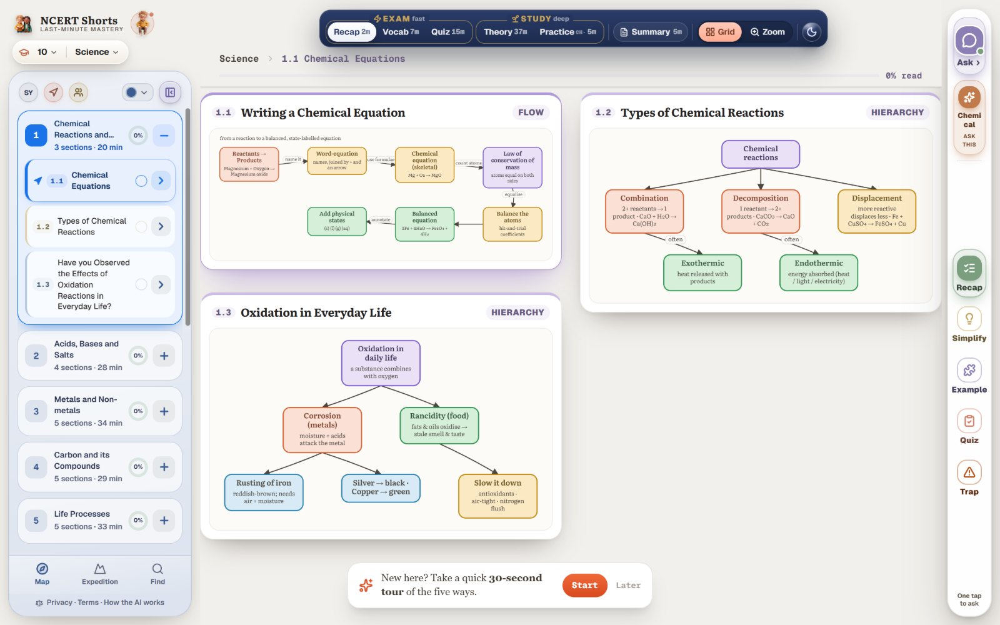
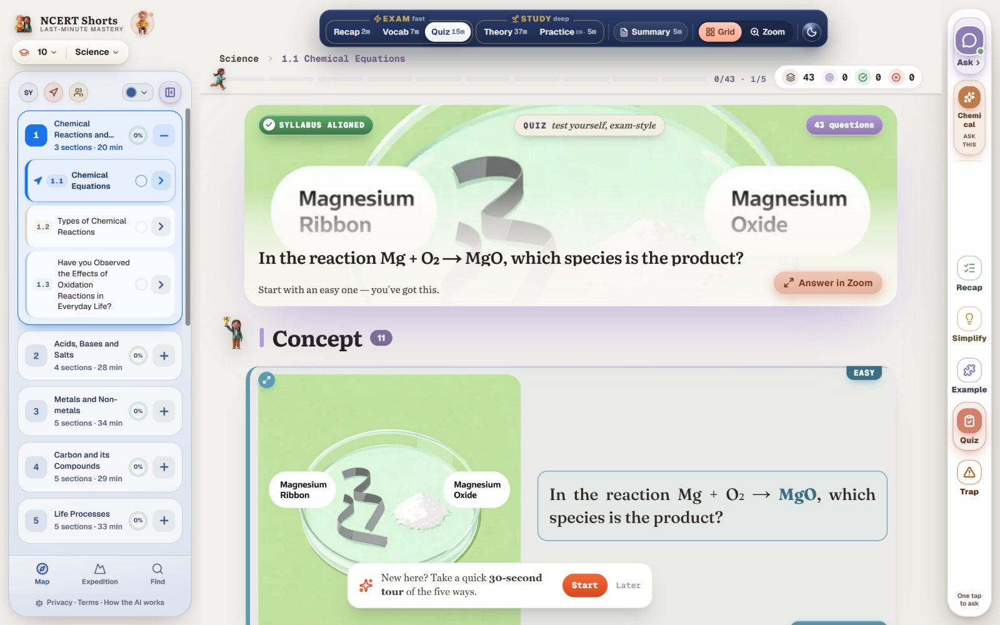
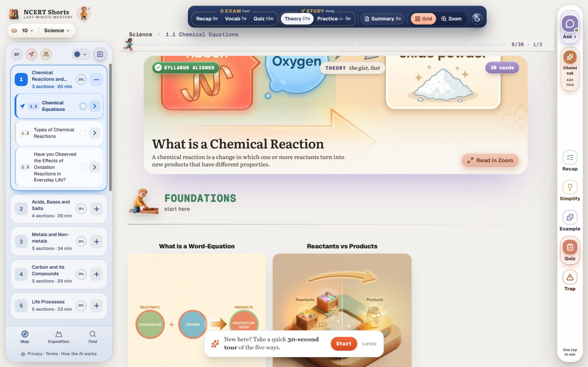
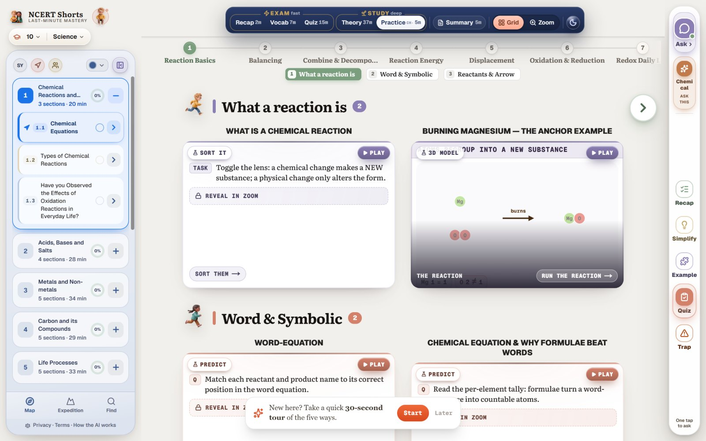
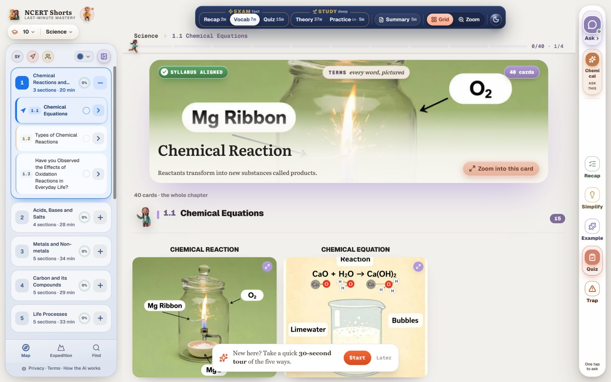
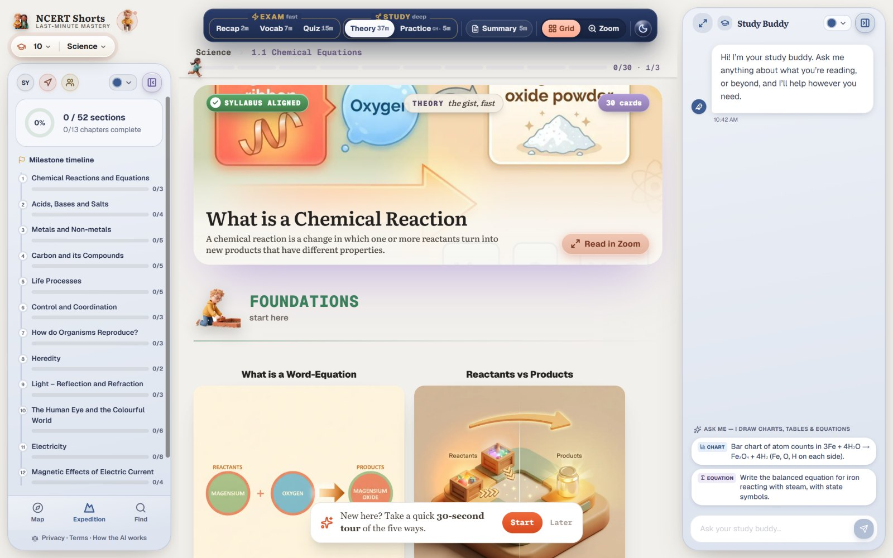
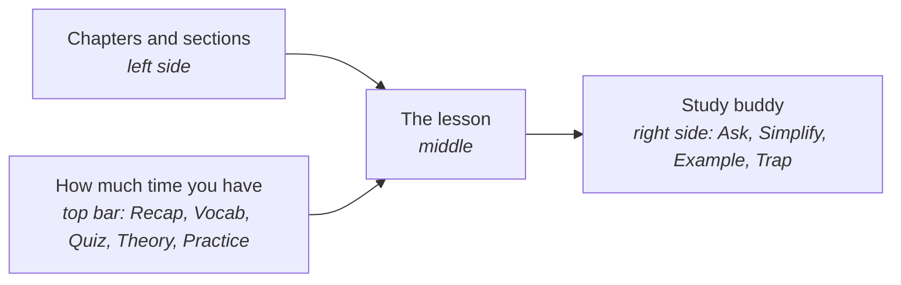
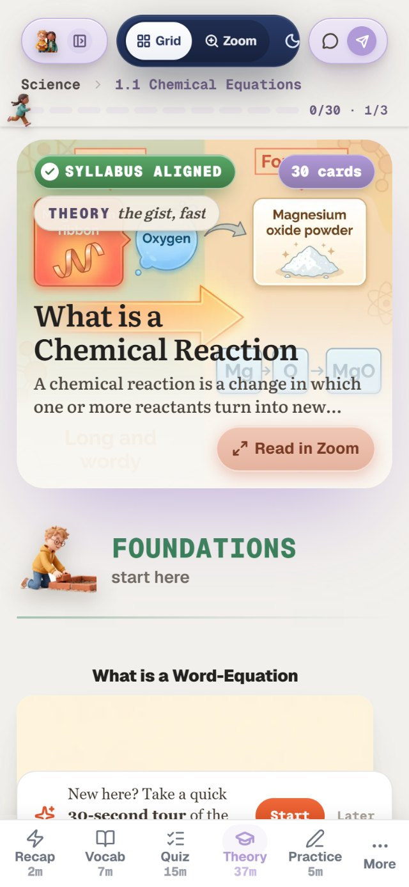

<div align="center">

<picture>
  <source media="(prefers-color-scheme: dark)" srcset="docs/images/logo-dark.svg">
  
</picture>

### Exam tomorrow? Revise fast. Confused on a topic? Go deep.

**[ncertshorts.com](https://ncertshorts.com)**

Class X Science &nbsp;·&nbsp; 13 chapters &nbsp;·&nbsp; 52 sections &nbsp;·&nbsp; free to open, nothing to install

[Open it](#open-it) &nbsp;·&nbsp; [Why it exists](#the-night-before-an-exam) &nbsp;·&nbsp; [The ways in](#one-topic-many-ways-in) &nbsp;·&nbsp; [How to read a page](#how-to-read-a-page) &nbsp;·&nbsp; [Report a mistake](#report-a-mistake) &nbsp;·&nbsp; [Questions](#questions)

<br>



</div>

<br>

## Open it

There is nothing to install and no account to make. Open the address on a laptop or a phone:

```text
https://ncertshorts.com
```

Pick a chapter on the left, then pick how much time you have along the top.

## The night before an exam

The textbook is the same for every student. The evening is not.

One student has the exam tomorrow morning and four chapters to get through. Another has a week, and is stuck on why an equation has to be balanced at all. Both open the same chapter and both are handed the same forty pages.

> **A student who is short of time and a student who is lost need different things from the same topic.**

NCERT Shorts gives every topic more than one way in. The student who is short of time takes the two-minute way. The student who is lost takes the slow one, with pictures, worked steps and somebody to ask.

| With the textbook alone | With NCERT Shorts |
|---|---|
| One telling of each topic, at one length | The same topic at two minutes, seven, fifteen, or as long as it takes |
| You find out what you missed in the exam | A quiz tells you tonight, question by question |
| A doubt waits until you can ask a teacher | The study buddy answers about the page you are on |
| A chapter is a wall of text | Each idea is one picture card, and a section is a map you can see whole |

## One topic, many ways in

The bar along the top of every page is sorted by the time you have.

<table>
<tr>
<td width="50%" valign="top">

**Recap, about two minutes**

The section as a map: every idea and how it joins the next, on one screen.



</td>
<td width="50%" valign="top">

**Quiz, about fifteen minutes**

Exam-style questions, each marked by how hard it is, that show what you missed.



</td>
</tr>
<tr>
<td width="50%" valign="top">

**Theory, when you have longer**

The full idea as picture cards, starting from the foundations. Read them as a grid, or one at a time in Zoom.



</td>
<td width="50%" valign="top">

**Practice**

Small things to do, not only to read: sort, predict, run the reaction and watch what changes.



</td>
</tr>
<tr>
<td width="50%" valign="top">

**Vocab, about seven minutes**

Every word the chapter turns on, each with its picture.



</td>
<td width="50%" valign="top">

**Ask**

Milo and Lila, the study buddies, answer about the page you are on. One press also gives a plainer telling, an example, a quick question, or the trap examiners set.



</td>
</tr>
</table>

### All of them, at a glance

| You have | Open | It gives you |
|---|---|---|
| Two minutes | **Recap** | The section in its shortest form, as a map |
| Seven minutes | **Vocab** | The words the chapter turns on |
| Fifteen minutes | **Quiz** | Questions that show what you missed |
| Half an hour or more | **Theory** | The full idea, as cards with pictures |
| Five minutes more | **Practice**, **Summary** | Things to do, and the chapter in one page |
| A doubt | **Ask** | An answer about the page you are on |
| A hard spot | **Simplify**, **Example**, **Trap** | A plainer telling, a worked example, and the mistake examiners wait for |

## How to read a page



| Where | What it is | What to do with it |
|---|---|---|
| Left | The 13 chapters, each with its sections and how long it takes | Pick where you are. Your progress shows beside each one |
| Top | The ways in, sorted from fast to deep, each with its minutes | Pick by the time you have, not by what you think you should do |
| Middle | The lesson in the form you picked | Read it as a **Grid** to see the whole section, or in **Zoom** to take one card at a time |
| Right | The study buddy | Ask when you are stuck. It answers about the page in front of you |
| Bottom left | **Map**, **Expedition** and **Find** | See the whole subject, follow your progress through it, or search for a topic |

<p align="center">

</p>

<p align="center"><sub>On a phone the same page folds into one column, with the ways in along the bottom.</sub></p>

## What is covered

**Today: Class X Science, all 13 chapters.**

| | | |
|---|---|---|
| 1 · Chemical Reactions and Equations | 6 · Control and Coordination | 11 · Electricity |
| 2 · Acids, Bases and Salts | 7 · How do Organisms Reproduce? | 12 · Magnetic Effects of Electric Current |
| 3 · Metals and Non-metals | 8 · Heredity | 13 · Our Environment |
| 4 · Carbon and its Compounds | 9 · Light: Reflection and Refraction | |
| 5 · Life Processes | 10 · The Human Eye and the Colourful World | |

**Where it is going:** the same treatment for Classes 9 to 12, one subject at a time.

## Report a mistake

A wrong fact in a study tool costs a student marks, so corrections come first.

| You found | Do this |
|---|---|
| A wrong fact, a wrong answer, a misleading picture | [Report a correction](../../issues/new?template=correction.yml). Say the chapter, the section and what is wrong |
| Something that does not work | [Report a problem](../../issues/new?template=problem.yml) |
| An idea | [Suggest it](../../issues/new?template=idea.yml) |

Inside the product, **Send feedback** at the top of any page does the same.

## Questions

<details>
<summary><b>Is it free? Do I need an account?</b></summary>
<br>
It opens without an account and without a payment.
</details>

<details>
<summary><b>Does it replace the NCERT textbook?</b></summary>
<br>
No. It follows the textbook's chapters and sections so that you can find your place, and it gives you more ways to take in each topic. The textbook remains the source your exam is set from.
</details>

<details>
<summary><b>Is the content written by AI?</b></summary>
<br>
AI is used in making the lessons and in the study buddy's answers. The product explains how, in plain words, under <b>How the AI works</b> at the foot of every page. If you find a mistake, report it here.
</details>

<details>
<summary><b>Does it work on a phone?</b></summary>
<br>
Yes. The page folds into one column with the ways in along the bottom.
</details>

<details>
<summary><b>Where is the code?</b></summary>
<br>
It is not published. This repository is the product's public home: what it is, how to use it, and where to send corrections. It holds no application code.
</details>

## About this repository

| | |
|---|---|
| **The product** | [ncertshorts.com](https://ncertshorts.com) |
| **Corrections, problems and ideas** | [Open an issue](../../issues/new/choose) |
| **Privacy and terms** | At the foot of every page of the product |
| **The source code** | Not published. See the [licence](LICENSE) |
| **Who makes it** | [Abbas Shaheer](https://github.com/syedabbasshaheer-art) |

**Independence.** NCERT Shorts is an independent study aid. It is not affiliated with, endorsed by, or sponsored by the National Council of Educational Research and Training (NCERT) or any examination board. "NCERT" names the textbooks whose chapters it follows.

<br>

<div align="center">
<sub>© 2026 Abbas Shaheer &nbsp;·&nbsp; all rights reserved</sub>
</div>
